<div align="center">


# Debrief

### Meeting minutes without taking notes.

Records your Google Meet tab, transcribes it as people actually talk (Hindi, English, Malayalam and every mix in between), and writes clean minutes with owners and action items.<br>
**No backend. No subscription.** It runs in your browser with your own API key.

[](#quick-start)
[](#languages)
[](#privacy)
[](#who-said-what)
[](#develop)

<br>

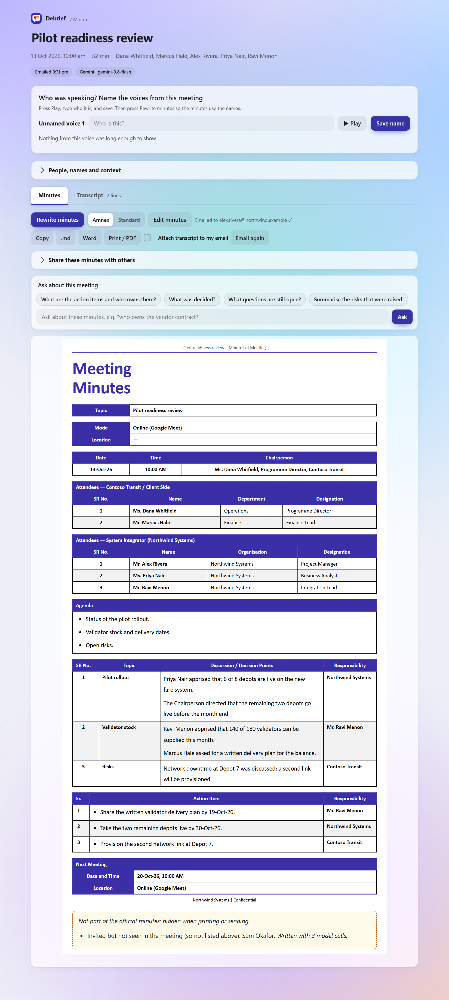

</div>

<br>

<table>
<tr>
<td width="33%" valign="top">

**1. Record**<br>
One click (or `Alt+Shift+M`) on a meeting tab. Your mic is optional and follows Meet's mute button.

</td>
<td width="33%" valign="top">

**2. Minutes appear**<br>
Decisions, owners and action items, written in the background. Close the tab; they are still written and emailed.

</td>
<td width="33%" valign="top">

**3. Send**<br>
Email them to yourself, share with the team, or copy, `.md`, Word and Print / PDF.

</td>
</tr>
</table>

---

## See it

<table>
<tr>
<td width="50%" valign="top">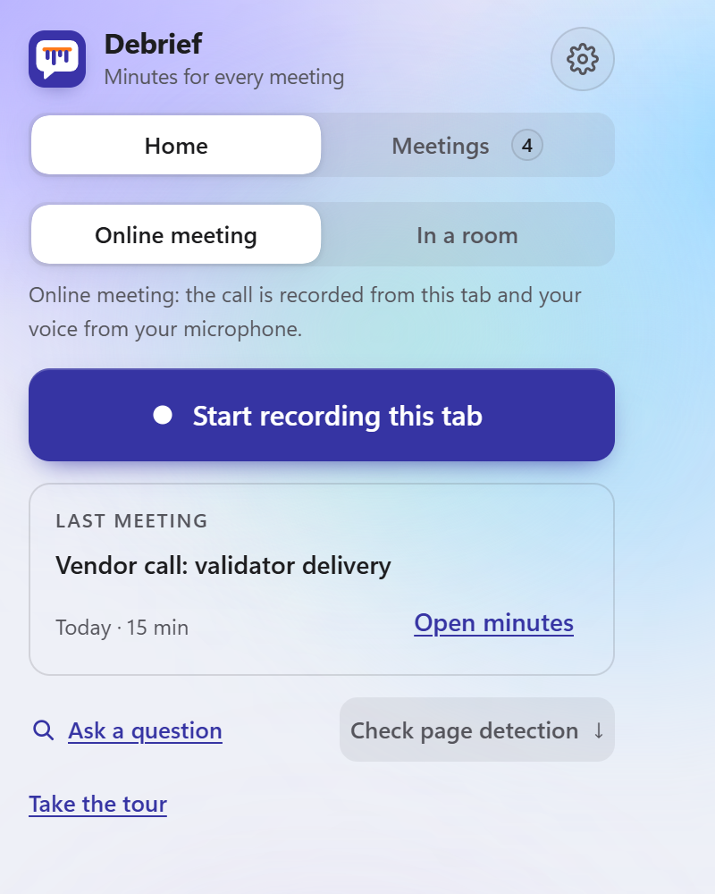<br><sub><b>The popup.</b> Liquid tabs, one big button. When a call is on, the button glows.</sub></td>
<td width="50%" valign="top">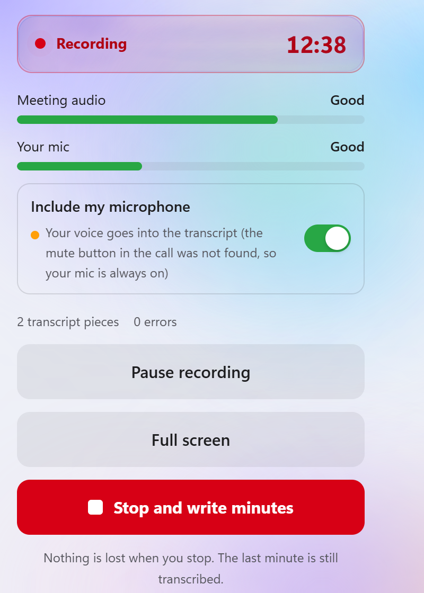<br><sub><b>Recording.</b> Live meters for the meeting and your mic, and a breathing glass bar.</sub></td>
</tr>
<tr>
<td width="50%" valign="top">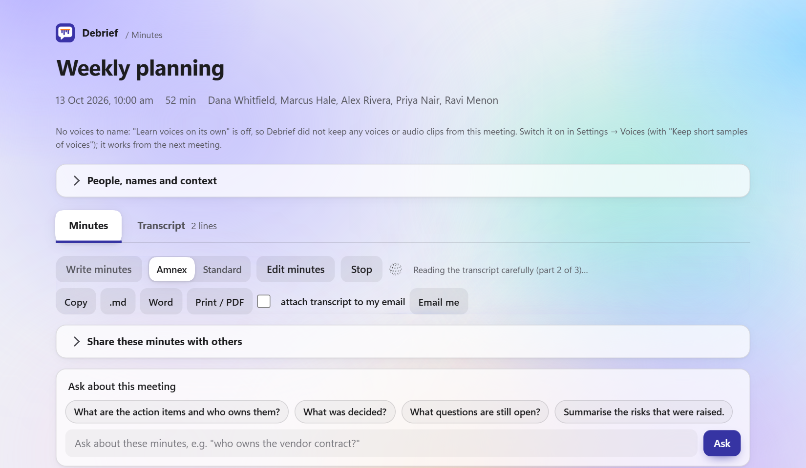<br><sub><b>Writing.</b> A thinking orb shows the stage (reading, writing, checking, emailing). Close the tab; it keeps going.</sub></td>
<td width="50%" valign="top">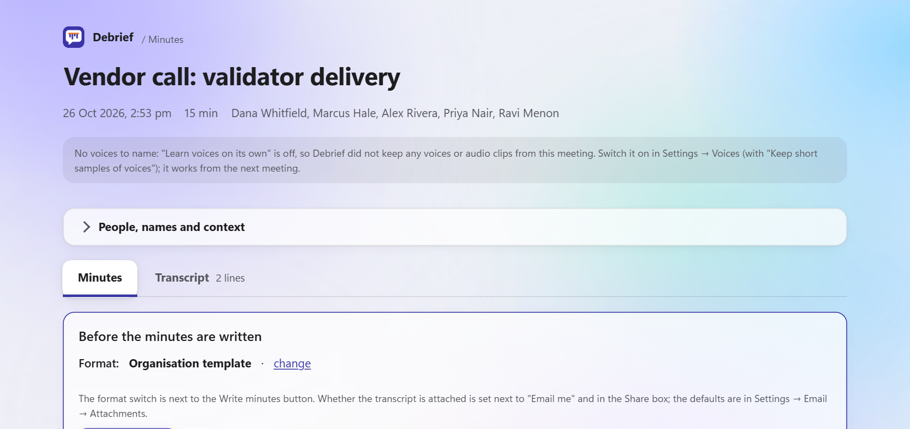<br><sub><b>After the call.</b> A 10 second window to pick the format; touch the page and it waits.</sub></td>
</tr>
<tr>
<td width="50%" valign="top">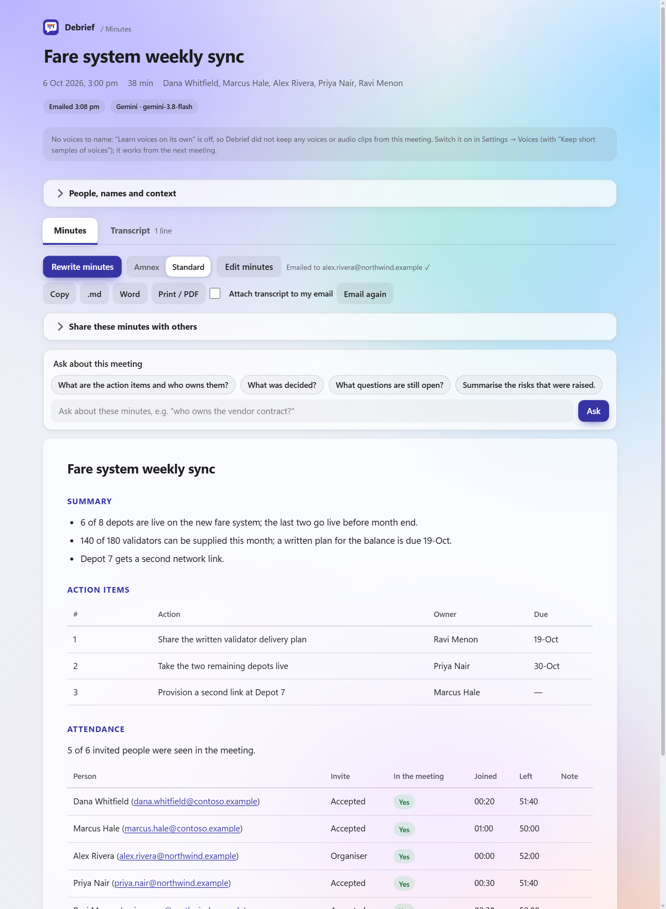<br><sub><b>Standard layout</b> with an attendance table: invited, seen, joined and left.</sub></td>
<td width="50%" valign="top">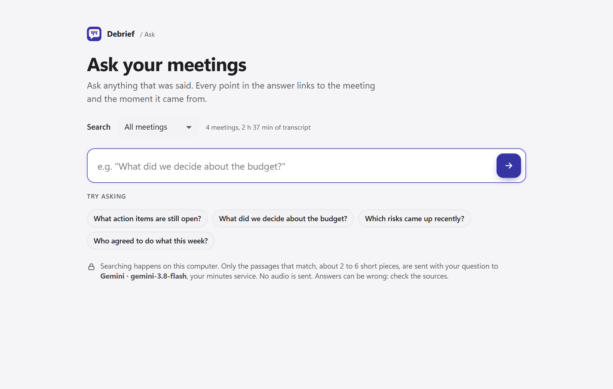<br><sub><b>Ask your meetings.</b> Anywhere you search or ask, the border beam lights the field.</sub></td>
</tr>
<tr>
<td width="50%" valign="top">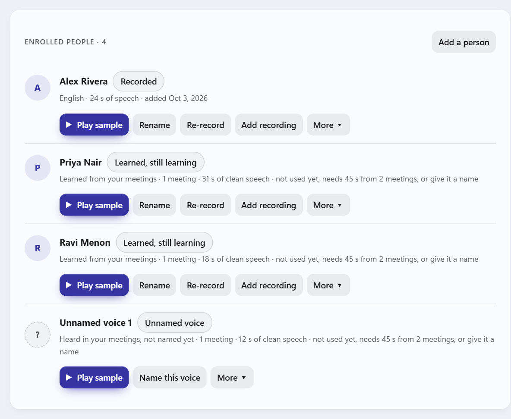<br><sub><b>Voices.</b> Name speakers by voice, on your computer. ▶ Play sample tells you who "Unnamed voice 1" is.</sub></td>
<td width="50%" valign="top">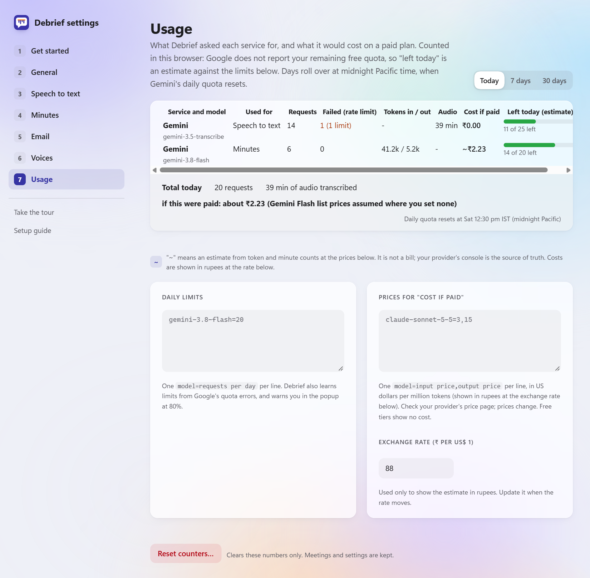<br><sub><b>Usage.</b> Requests, tokens and audio per model, and an honest estimate of the free quota left.</sub></td>
</tr>
<tr>
<td width="50%" valign="top">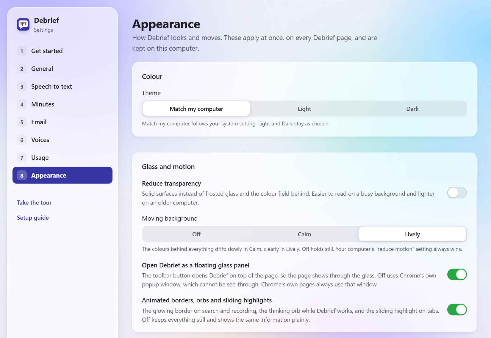<br><sub><b>Appearance.</b> Light, dark or follow the computer; the on-page pill; the toolbar recording icon.</sub></td>
<td width="50%" valign="top">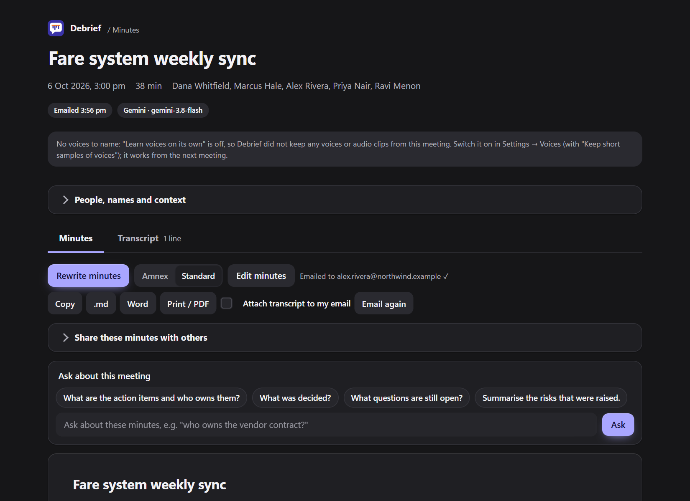<br><sub><b>Dark.</b> The same solid surfaces in the dark theme.</sub></td>
</tr>
<tr>
<td width="50%" valign="top">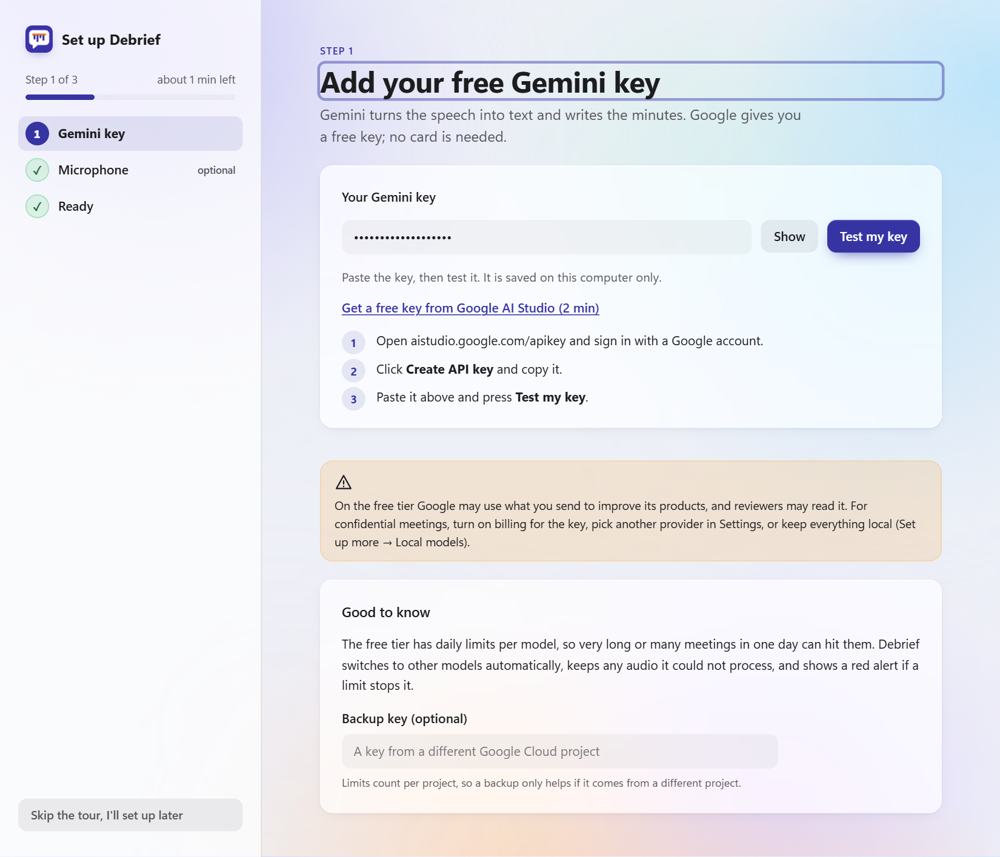<br><sub><b>Two-step first run.</b> Paste a free Gemini key (tested live), allow the microphone, record.</sub></td>
<td width="50%" valign="top">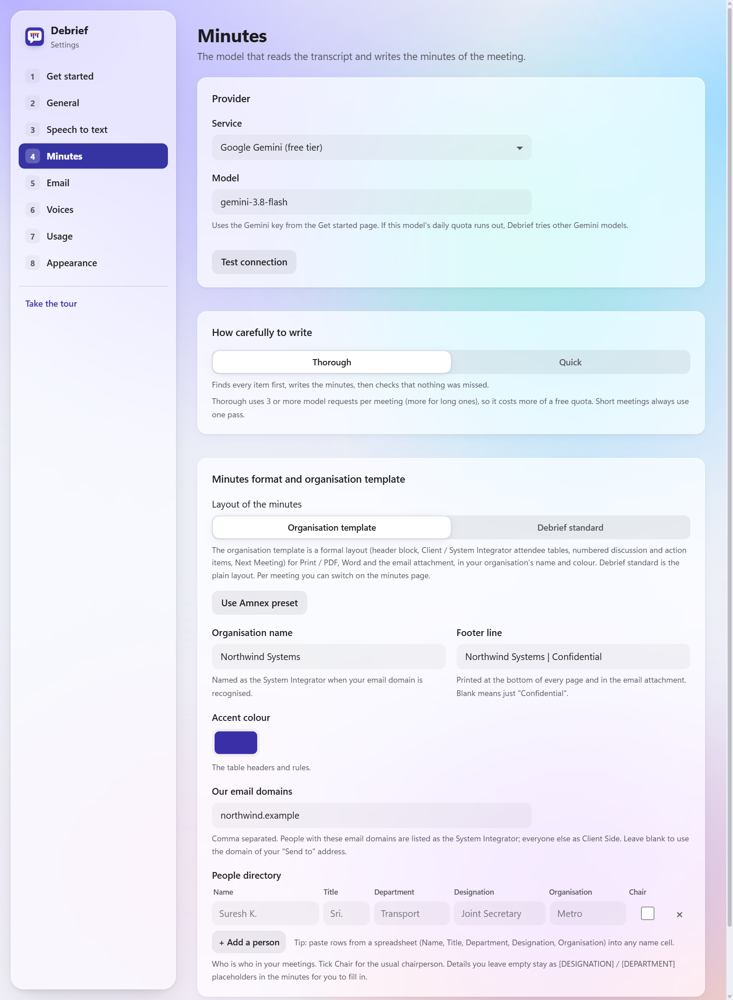<br><sub><b>Organisation template.</b> Your name, footer line and colour on the formal minutes.</sub></td>
</tr>
</table>

<div align="center">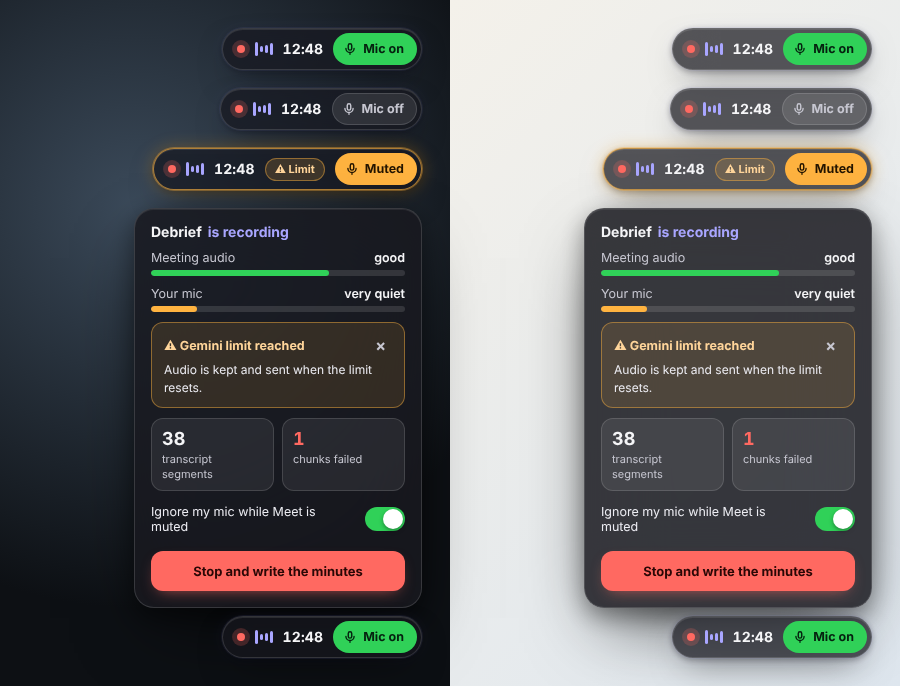<br><sub>The optional pill on the Meet page: timer, mic button, alerts. Off by default.</sub></div>

### The look

Solid, calm and readable: opaque surfaces, one accent colour, light and dark, no blur and no animated background. One design system (`extension/style.css`, see [docs/DESIGN-SYSTEM.md](docs/DESIGN-SYSTEM.md)) follows Apple's Human Interface Guidelines: system type scale, 44 px hit targets, 4.5:1 text contrast. Debrief lives in Chrome's side panel. **Settings → Appearance** sets the theme (light, dark or follow your computer), the on-page recording pill and the toolbar recording icon. Your computer's high-contrast setting is always respected.

---

## Why it exists

Meeting notes in India are in Hinglish: Hindi sentences with English words in the middle, switching mid-sentence. Most transcribers mangle that. Debrief records the call, cuts the audio at natural pauses, sends it to a model that handles code-switching, and turns the transcript into minutes you can paste straight into an email or a ticket.

## What you get

| | |
|---|---|
| **One-click recording** | Popup or `Alt+Shift+M`. The toolbar icon glows amber during a call as a reminder (Meet, and Zoom, Teams, Webex, Whereby, Jitsi and others in the browser). |
| <a name="languages"></a>**Any language, any mix** | Tick the languages your meetings use from 20 (English, Hindi, Malayalam, Tamil, Telugu, Kannada, Marathi, Bengali, Gujarati, Punjabi, Odia, Urdu, Spanish, French, German, Portuguese, Russian, Arabic, Chinese, Japanese) or leave them on automatic. Each is written in its own script; English words stay English. |
| **Minutes that leave nothing out** | *Thorough* mode reads the transcript window by window, writes the minutes with that checklist, then audits them against the transcript and appends anything missing. Invented owners are dropped. |
| **Written in the background** | A runner writes the minutes and sends the email even if you close the minutes tab. If Chrome restarts mid-way, the job resumes and the email is sent once. |
| **Two layouts** | A formal **organisation template** (header block, Client / System Integrator attendee tables, numbered discussion, action items, Next Meeting; Print / PDF, Word and email) or the plain **Debrief standard**. Switch per meeting. |
| **Attendance** | Invited (from your calendar) against who was actually seen, with late joiners, early leavers and absentees. Rows read "Name (address)" and Debrief learns who is who from each meeting. |
| **Ask your meetings** | Ask about one meeting or all of them. Answers cite the source of every point, and say so when it isn't in your meetings. |
| <a name="who-said-what"></a>**Who said what** | Optional on-device voice recognition names the other speakers, saying *Unknown speaker* when unsure. Fingerprints stay in your browser. |
| **Email and share** | Auto-email from *your own* Gmail through a script you deploy once, with PDF / Word / Markdown / transcript attachments. Share with recipient lists (To / Cc / Bcc). |
| **Names that are right** | A personal dictionary (`Amal \| Aman`) and a per-meeting attendee list fix misheard names; Debrief remembers fixes. |
| **Fewer API requests** | With Gemini and your mic on, the call and your voice go in one request per piece. A "4 minute pieces" setting and a popup warning when a one-hour meeting won't fit today's free quota. |
| **Local models** | One-click presets for Ollama and a local Whisper server. Audio and text never leave your computer. |
| **Never loses audio** | If a service is down or out of quota, the audio is kept and retried. Red alerts say which model ran out and when it resets. |

## Quick start

You need Chrome 116+ and Node.js (only to build).

```bash
git clone https://github.com/devshrawin/Debrief.git
cd Debrief
git checkout pro
npm install
npm run build
```

1. Open `chrome://extensions`, switch on **Developer mode**, click **Load unpacked** and pick the `extension/` folder.
2. The tour opens by itself: paste a free Gemini key from [aistudio.google.com/apikey](https://aistudio.google.com/apikey) (no card needed), allow the microphone, done. Everything else (name, voices, email, sharing, local models) is an optional "Set up more" list you can open any time from the popup (**Tour**).
3. Join a Meet, click the Debrief icon, press **Start recording this tab**.
4. Press **Stop**. The minutes page opens and, after a 10 second countdown, the minutes are written (and emailed, if you set that up).

> Free-tier Gemini data may be used by Google and seen by reviewers. For confidential meetings, turn on billing for the key, use another provider, or run local models.

More: [setup guide](docs/SETUP.md) · [local models](docs/LOCAL.md) · [store listing notes](docs/STORE.md) · [audit and status](docs/AUDIT.md)

## How it works

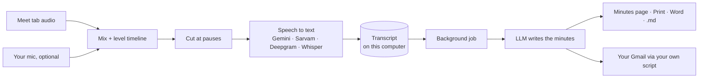

- Everything runs in the browser. There is no Debrief server.
- With Gemini and the mic on, tab and mic are mixed into one stream and *who spoke* is worked out afterwards from how loud each side was. Other providers keep two separate streams.
- The minutes pipeline (`src/jobs.js`) runs in a background document, writes progress onto the meeting record, and the minutes page is just a viewer that shows it.

## Privacy

| | |
|---|---|
| **Your keys** | Stay in this browser (Chrome extension storage, unencrypted, as on any extension). |
| **Audio and text** | Go straight from Chrome to the provider you chose (Gemini by default; Sarvam, Deepgram, Claude, or models on your own computer). If you turn on email, minutes also pass through a script in your own Google account. |
| **Voices** | Recognition runs on your computer with a bundled model. Only 256-number fingerprints are stored, plus optional short sample clips you can play back and delete. **Forget all voices** removes everything. |
| **The local helpers** | The Whisper server only answers local requests from the Debrief extension. |

Tell participants when you are recording; your workspace may also restrict extensions.

## Honest status

Debrief Pro is in active development. This is what has and hasn't been seen working.

| Verified (tests and real headless Chrome) | Needs a live call to confirm |
|---|---|
| Recording plumbing, transcription clients, minutes pipeline, both layouts | Me / others attribution with the mixed mic + tab stream |
| Background job: minutes written with no tab open, resume after a restart, one job per meeting | The automatic email after closing every Debrief tab |
| Voices: naming, merge, ▶ Play sample, cleanup | The mail relay v8 on a real Apps Script deployment |
| Org template, migration of existing installs, tour, attendance names | Speaker-recognition accuracy (only one small smoke test so far) |

Known limits: the Gemini free tier still runs out on long meetings; matching names gets slow with 800+ invitees sharing a first name; names with accents don't match addresses; speaker names, captions and attendance are Google Meet only (other apps: audio recording, best-effort mute and end detection). Details in [docs/AUDIT.md](docs/AUDIT.md).

---

<details>
<summary><b>Voice recognition</b> (optional, best guess)</summary>

Everything is off until you turn it on in **Settings → Voices**.

**How it works.** While recording, the other participants' audio is cut into 1.5 to 4 second pieces of speech. A pretrained speaker model turns each piece into a fingerprint of 256 numbers, in a web worker inside your browser. The fingerprints are compared with the people you enrolled. Transcription is unchanged; each passage is split into sentences and placed on the speech in proportion to its length.

**What leaves your computer.** Nothing for this feature. The model ships with the extension and runs locally. The recording you make when enrolling stays in memory until you save; then the fingerprint (and, if sampling is on, a short clip you can play back) is kept. **Forget all voices** deletes them, including the fingerprints kept with past meetings.

**The model.** [WeSpeaker](https://github.com/wenet-e2e/wespeaker) ResNet34-LM, ONNX, 26.5 MB, 256-dimension embedding, run with ONNX Runtime Web (WASM, MIT). CC-BY-4.0, see [NOTICE.md](NOTICE.md).

**Using it**
1. **Settings → Voices → Add a person.** Type the name, pick the language, record about 20 seconds in a quiet room, play it back, Save. Add a second recording per language for someone who switches.
2. Turn on **Name speakers by their voice** and Save. Names appear in the transcript, minutes, Ask and attendance.
3. **Learn on its own (optional).** Voices that keep coming back are grouped as *Unnamed voice 1, 2…*. Name one once and it is named in every meeting. A learned voice is not used until it has about 45 seconds of clean speech from two meetings.
4. **Right after a meeting** the minutes page shows a **Who was speaking?** box for unnamed voices, each with ▶ Play. Type the name, save, press **Rewrite minutes**.
5. **Export / import** voices as a file of fingerprints. Share only with the people's agreement.
6. **Room mode.** For an in-person meeting the popup's *In a room* switch labels lines by voice instead of with your name.

**Limits, honestly.** It is a statistical best guess: similar voices, echo, poor microphones and people talking over each other cause mistakes, and overlapping or low-confidence pieces are shown as *Unknown speaker* on purpose. Where Meet's captions name someone else, both names are shown. Accuracy on real meetings has not been established; check names before relying on them. A voice fingerprint identifies a person: tell people before you build profiles of them.

**Pause and full screen.** `Alt+Shift+P` pauses (nothing is transcribed or kept while paused); `Alt+Shift+F` follows Meet's full screen with the whole window.

</details>

<details>
<summary><b>Email the minutes</b></summary>

Debrief mails you the minutes as soon as they are written, as a clean HTML email with optional attachments (PDF, Word, Markdown, transcript). There is no server of ours in the loop: the extension posts to a small script in **your** Google account, which sends the email as you. One-time setup, about 2 minutes:

1. **Settings → Email → Copy the script** (it already contains this install's secret).
2. Open [script.google.com](https://script.google.com/home/start), **New project**, paste, save. The source is [`apps-script/Code.gs`](apps-script/Code.gs).
3. **Deploy → New deployment → Web app**, *Who has access: Anyone*, Deploy, allow access.
4. Paste the **Web app URL** into Debrief and press **Send test email**.

Safety: whatever a request says, the script only ever mails **your own address** plus those on its `ALLOWED` list, and it only answers the Debrief install whose secret is on its `SECRET` line. After reinstalling Debrief or using a new browser profile, copy the script again and deploy a new version. Rewriting or editing minutes never re-sends by itself; press **Email me** to send again. Details and troubleshooting: [setup guide](docs/SETUP.md#5-email-the-minutes-to-yourself-optional).

**Sharing.** Recipient lists per recurring meeting; you get the email first and press **Share** after checking it (or let it go out automatically). To / Cc / Bcc, replies come to you.

</details>

<details>
<summary><b>The organisation template</b></summary>

**Settings → Minutes** has a **Minutes format and organisation template** card. The template is generic by default. Set your **organisation name**, **footer line**, **accent colour** and **email domains**, or press **Use Amnex preset** to fill the Amnex values in one click. Installs that existed before this option keep the Amnex look.

In the template format the minutes are a formal document: title, header block (Topic, Mode, Location, Date, Time, Chairperson), attendee tables split into **Client Side** and **System Integrator**, Agenda, a numbered Discussion table with Responsibility, numbered Action Items, and Next Meeting.

**Code builds the facts; the model writes only the wording.**

| Part | Who fills it |
|---|---|
| Topic, date, time, mode, location | code, from the meeting record |
| Attendee tables, numbering, Client / System Integrator split | code, from the invite and who was seen or heard, split by email domain |
| Honorific, department, designation, chairperson | code, from your **People directory** (`Name \| Honorific \| Department \| Designation \| Organisation [\| Chair]`); unknown ones stay `[DESIGNATION]` etc. |
| Agenda, discussion rows, action items, next meeting | the model, in a strict shape that code parses |
| Responsibility column | the model proposes, code checks: only a known attendee, a known organisation or a name actually said survives; anything else becomes `[RESPONSIBILITY]` |

If the model's reply doesn't fit the template, standard minutes are written instead and the status line says so. A line `Chairperson: Name` in the context box names the chair for one meeting.

**Where it appears.** *Print / PDF* (A4, repeating header rows, *Page X of Y* and your footer line), *Word* (per-cell borders and fills, Word header and footer fields), and the *email* (a short cover with the full document attached). The PDF built by the Apps Script relay comes from Google's HTML converter, which ignores `@page`, so use *Print / PDF → Save as PDF* when page numbers matter.

</details>

<details>
<summary><b>Providers and free-tier quotas</b></summary>

| Stage | Options | Notes |
|---|---|---|
| Speech-to-text | **Google Gemini** `gemini-3.5-transcribe` (default) | Free key, code-switching aware; general Gemini models take over if it returns nothing or runs out. |
| | **Sarvam AI** `saaras:v4` | Strong Hinglish; `codemix` writes Hindi in Devanagari and English in Latin. |
| | **Deepgram** `nova-3` | Hindi-English code-switching. No Malayalam. |
| | **OpenAI-compatible Whisper** | Groq, OpenAI, or a local server such as `http://localhost:8000/v1`. |
| Minutes | **Gemini** `gemini-3.8-flash` (default) | Same key; falls back across Gemini models on quota errors. |
| | **Claude** | Default `claude-opus-5-5`. |
| | **OpenAI-compatible chat** | OpenAI, Groq, OpenRouter, Ollama, LM Studio. |

Model IDs follow each provider's naming; `gemini-3.5-transcribe` and `nova-3` are confirmed in release notes, `gemini-3.8-flash` and `saaras:v4` could only be confirmed on third-party pages.

**Free-tier quotas.** Google limits requests per model, per project, per day; a second key from the same project shares that limit. Debrief tries your model, then other models (each has its own quota), on both keys; keeps the audio if everything is spent; and raises a red alert. It also reduces how many requests a meeting needs (one mixed stream, longer pieces on request) and warns in the popup if a one-hour meeting won't fit what is left today (close it with ×). For heavy use add a key from a *different* Google Cloud project, or enable billing.

</details>

<details>
<summary><b>Troubleshooting</b></summary>

| Symptom | What it means |
|---|---|
| Amber bars, "no audio data" | The recorder is not running. Stop and start again. |
| Meeting audio meter says *silent* | The Meet tab is muted or nobody is talking. Capture works per tab. |
| Mic meter says *silent* | Wrong input device, or Meet is muted and follow-mute is on. |
| Red "API limit reached" | A model's free quota is spent. The audio is kept. Wait, add another project's key, or enable billing. |
| Red "API key rejected" | The key is invalid or lacks access. Re-paste it in Settings. |
| Malayalam comes out as English letters | Set **Meeting language** to *Malayalam + English*. |
| Minutes never appeared | Open the meeting from the popup's Meetings tab: the job state and any error are shown there. A held countdown waits for **Write minutes**. |
| Test email says "set up for a different Debrief install" | Copy the script again from Settings → Email, paste it over the old one, deploy a new version. |

**Settings → Get started → Check my setup** lists what is ready and what isn't (keys, quota, microphone, mute button, email relay, voices, your last meeting) without showing any secret.

</details>

## Develop

```bash
npm run build        # bundle src/ into extension/dist/ (and the theme script into extension/fx/)
npm run watch        # rebuild on change
npm test             # 17 suites (243 checks): chunker, mixer, providers on a mocked fetch,
                     # minutes pipeline, jobs, relay script, voices, org template, migration
node test/chrome-smoke.mjs   # real headless Chrome drives every page
node test/chrome-job.mjs     # real Chrome: minutes written with no tab, resumed after a restart
node test/chrome-sidepanel.mjs   # real Chrome: every side-panel state at 320, 420 and 600 px, light and dark
npm run pack         # release/Debrief-Pro-v<version>.zip for the Web Store (no dev key)
npm run src-zip      # source zip without node_modules, release, .git, dist
node scripts/screenshots.mjs # regenerate the screenshots in docs/img
```

```
apps-script/Code.gs   the mail relay you deploy in your own Google account
src/
  background.js       service worker: recording state, mic logic, alerts, job start and resume
  offscreen.js        audio capture, mixing, chunking, transcription; hosts the minutes job runner
  mixer.js            mic + tab mixing, me / others from levels
  chunker.js          pause-aware chunking
  stt.js, gemini.js   speech-to-text clients and model fallback
  ../fx/src           the one-line theme script (light / dark), built into extension/fx/theme.js
  jobs.js             the minutes job: pipeline, runner, email and share (shared by the page and the background)
  jobstate.js         job states and resume rules
  minutes.js          the multi-pass minutes pipeline
  amnex.js            the organisation template: facts, parsing, A4 / Word / email rendering
  attendance.js       invited vs present, "Name (address)", learned names
  llm.js, prompt.js   minutes generation and prompts
  mailer.js           builds and sends email through the relay
  voice/              speaker model, matching, learning, enrolment, clips
  dictionary.js       names and terms, attendee-aware correction
  usage.js            request / token counters, limit learning, quota check
  adapters/           page readers: Meet, and a generic one for other meeting apps
  popup.js, mom.js, options.js, welcome.js, pill.js   the pages
docs/                 setup, local models, store notes, audit, screenshots
```

The manifest pins the extension ID (`nckojmcchehoejdfklcmllhpekagiddo`) with a `key`; the store package leaves the key out (see [docs/STORE.md](docs/STORE.md)).

## Caveats

- **Tell participants you are recording.** Your workspace admin may block extensions or tab capture.
- **Use headphones**, or your mic also hears the speakers and lines appear twice.
- Chrome allows one recording tab at a time.
- Muting in Meet does not mute Debrief's mic stream, which is why Debrief follows Meet's mute button. If Meet changes its page and the state can't be read, use the mic button manually.

## Roadmap

- Speaker names from Meet's active-speaker indicator
- Voice recognition: measure accuracy on real labelled meetings and tune the thresholds
- Word-level timestamps for exact speaker boundaries
- Pill warning for the daily quota
- Slack / Teams / WhatsApp delivery of the minutes

---

<div align="center">

Built by <a href="https://github.com/devshrawin">@devshrawin</a>

</div>
