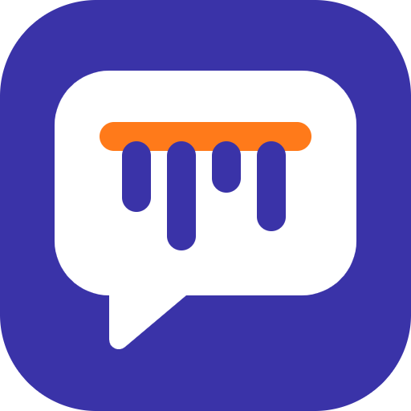
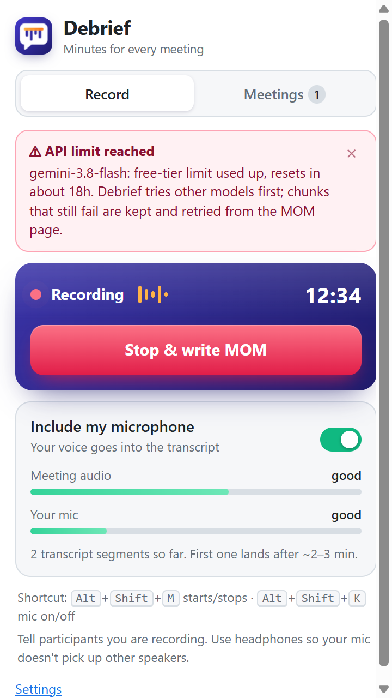
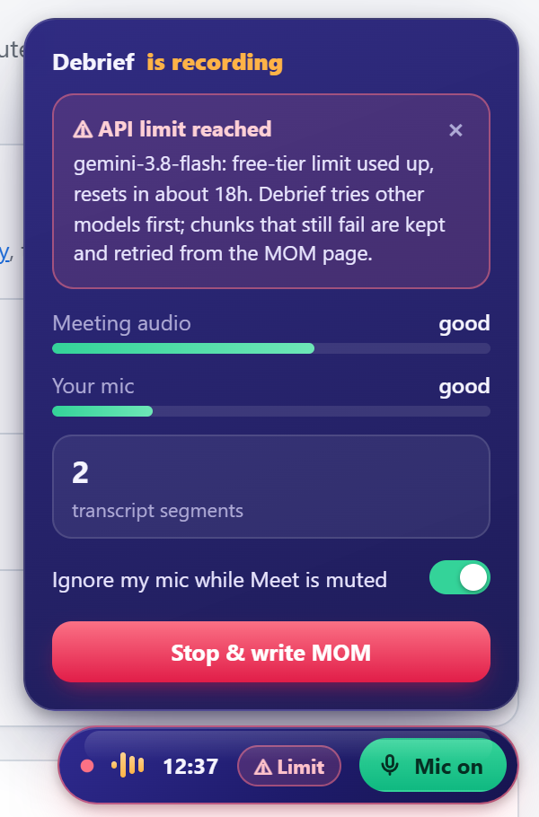

<div align="center">



# Debrief

**Minutes for every meeting, in Hindi, English, Malayalam and the mixes in between.**

Records your Google Meet tab, transcribes it as people actually talk (code-switching and all), and writes clean Minutes of Meeting with action items. No backend, no subscription: it runs in your browser with your own API key, and the default setup is free.


<br>


&nbsp;&nbsp;&nbsp;


</div>

---

## Why it exists

Meeting notes in India are in Hinglish: Hindi sentences with English words in the middle, switching mid-sentence. Most transcribers mangle that. Debrief records the call, cuts the audio at natural pauses, and sends it to a model that handles code-switching, then turns the transcript into minutes you can paste straight into an email or a ticket.

## Features

| | |
|---|---|
| **One-click recording** | Start from the popup or press `Alt+Shift+M`. The toolbar icon glows amber during a call as a reminder to record (Google Meet, and Zoom, Teams, Webex, Whereby, Jitsi, GoTo, BlueJeans, Chime, Zoho Meeting and Skype in the browser). |
| **Any languages, in any mix** | Tick as many of 20 languages as your meetings use (English, Hindi, Malayalam, Tamil, Telugu, Kannada, Marathi, Bengali, Gujarati, Punjabi, Odia, Urdu, Spanish, French, German, Portuguese, Russian, Arabic, Chinese, Japanese), or leave all unticked for automatic. Each language is written in its own script and English words stay in English. Gemini gets all of them as hints; Sarvam and Whisper-style servers are narrowed to the language when you pick exactly one. |
| **Ask your meetings** | Ask a question on any minutes page, or across all your meetings from the popup (**Meetings → Ask a question**). Debrief finds the best-matching excerpts locally and answers with the source of every point, e.g. `[Cadence call, 12 Oct, 14:20]`. Nothing is guessed: if it isn't in your meetings it says so. |
| **Mic on your terms** | Switch your own voice in or out of the transcript from the popup, with `Alt+Shift+K`, or from an optional compact pill on the Meet page. |
| **Follows Meet's mute** | While Meet itself is muted, Debrief ignores your mic, so side conversations stay out of the transcript. |
| **Live health meters** | See meeting-audio and mic levels in the popup and the optional pill. If the recorder dies or the meeting is silent, you see it immediately instead of after the call. |
| **API limit alerts** | When a free-tier quota runs out or a key is rejected, the popup (and the optional pill) turn red and Chrome shows a notification. Nothing is lost: failed audio is kept and retried. |
| **Quota-proof by design** | Free quotas are per model. Debrief falls back across several Gemini models and both of your keys before giving up. |
| **Noise-proof transcripts** | Looped filler that models invent on silent or noisy audio is detected and dropped. |
| **Stops by itself** | Debrief spots Meet's "you left" and "meeting ended" screens (or you leaving the call page) and stops the recording, then writes and emails the minutes. A silence timer (default 10 minutes) is the safety net. Both are in Settings → General → Recording. |
| **Auto-email** | The minutes land in your inbox the moment they're written, as a clean HTML email (tables intact), with the transcript attached if you like. It sends from *your own* Gmail through a 40-line Google Apps Script you deploy once. See [Email the MOM](#email-the-mom). |
| **MOM your way** | Streams Markdown minutes: summary, decisions, action items table. Edit, copy, export `.md`, Word or PDF. Write in English or Hindi. |
| **Manage meetings** | Delete a single meeting or clear them all from the popup. |
| **Private** | Debrief has no server of its own. Audio and text go from your browser to the services you choose (Gemini by default, or Sarvam, Deepgram, Claude, or models on your own computer), and your keys stay in this browser, stored unencrypted in Chrome's extension storage. If you turn on email, the minutes and any attachments also pass through a script in your own Google account. |

## New in Pro

This branch (`pro`) adds, on top of everything above:

| | |
|---|---|
| **Names that are right** | A personal dictionary (`Amal | Aman`) corrects misheard names in the transcript and feeds the speech and minutes models. A per-meeting attendee list makes it smart: "Aman" becomes "Amal" only if Amal is in the meeting and Aman is not. Fix a name once on the minutes page and it is remembered. |
| **Learns by itself** | After each meeting Debrief remembers the real names it saw (people in the call, the invite, your attendee list) as spelling hints, and queues likely mishearings (a word that keeps appearing one letter off a real attendee's name) for one-click approval in Settings. An optional switch accepts clear-cut fixes automatically. |
| **First-run tour** | A guided tour opens on install: key, microphone, language, names, how to record, email, sharing, local models and limits, with live tests along the way. Reopen it from the popup. |
| **Minutes that leave nothing out** | *Thorough* mode reads the transcript window by window to extract every decision, action, question and risk, writes the minutes with that checklist, then audits the result against the transcript and appends anything missing. Every action item carries a timestamp and a quote so you can verify it. Invented owners are dropped when the transcript does not name them. A coverage warning appears if audio could not be transcribed. |
| **Attendance** | The minutes include an attendance table: invited (from your Google Calendar through your relay script) against who was actually seen in the meeting, with late joiners, early leavers, absentees and uninvited guests. Action items for absent people are flagged. |
| **Speaker names** | Meet's live captions are read for who was speaking when, and given to the minutes writer to attribute statements. *Check page detection* in the popup shows what Debrief can read from your Meet page. |
| **Share with your team** | Recipient lists, per recurring meeting. You get the email first; press **Share** after checking it, or let it go to everyone automatically. To / Cc / Bcc, replies come to you, and the script only mails people you allow (single addresses or whole company domains). |
| **Usage** | A Usage page counts requests, tokens, audio minutes and quota hits per model (today, 7 and 30 days), learns daily limits from Google's own error messages, and warns in the popup at 80%. |
| **Local models** | One-click presets for Ollama and local Whisper servers, an installed-model picker, context-length advice, and smaller reading windows for small models. See the [local models guide](docs/LOCAL.md). |
| **Who is speaking (voice recognition)** | Optional, off by default. Add people in Settings → Voices by recording about 20 seconds of each (English, Hindi, Malayalam or free speech), and the transcript, minutes, Ask and attendance name speakers by voice, saying *Unknown speaker* when unsure. It runs in your browser with a bundled model, stores only numeric fingerprints, can learn voices from Meet captions over several meetings, and voices can be exported and imported. See [Voice recognition](#voice-recognition). |
| **Other meeting apps (experimental)** | Optional generic detection for Teams, Zoom web, Webex, Whereby and Jitsi: mute follow and end-of-call detection. |

## Voice recognition

Debrief Pro can put names to voices, as a **best guess**. Everything is switched off until you turn it on in **Settings → Voices**.

**How it works.** While recording, the other participants' audio is cut into 1.5 to 4 second pieces of speech. A pretrained speaker model turns each piece into a fingerprint of 256 numbers, in a web worker inside your browser. The fingerprints are compared with the people you enrolled. The transcription itself is unchanged: the same chunks go to the same speech-to-text model, and each passage is split into sentences that are matched to the pieces of speech heard at that time.

**What leaves your computer.** Nothing for this feature. The model ships with the extension (no download) and runs locally. The recording you make when enrolling stays in memory until you save, then the fingerprint (and, if sampling is on, a short clip) is kept. (Speech-to-text and the minutes are sent to the providers you chose, exactly as before.) Fingerprints saved with a meeting are deleted by **Forget all voices**, or when you delete the meeting. The one exception is on by default and can be switched off: **Keep short samples of voices** keeps one clip of about 8 seconds per voice (learned, named, or recorded by you in Settings) in this browser (never uploaded) so you can press *Play sample* in Settings → Voices and hear who it is. The clip is deleted when you delete or merge the voice, or press **Forget all voices**, and tell the people on your calls before you switch it on.

**The model.** [WeSpeaker](https://github.com/wenet-e2e/wespeaker) ResNet34-LM, ONNX, 26.5 MB, 256-dimension speaker embedding, run with ONNX Runtime Web (WASM, MIT). The WeSpeaker model files are licensed CC-BY-4.0 (see [NOTICE.md](NOTICE.md)). It was chosen because it is small, runs well on a CPU, and is a published, widely used speaker model that needs no training here.

**Using it.**
1. **Settings → Voices → Add a person.** Type the name, pick the language they use in meetings, press *Record*, and read the text for about 20 seconds in a quiet room. Play it back, then *Save*. Add a second recording per language for someone who switches (*Add recording*), re-record, rename or delete at any time.
2. Turn on **Name speakers by their voice** and Save. Names then appear in the minutes page transcript, the downloaded and emailed transcript, the prompts to the minutes writer and Ask, and attendance (people heard speaking count as present).
3. **Learn on its own (optional).** Voices that keep coming back across meetings are grouped as *Unnamed voice 1, 2…* (no captions, any language). Rename one once and it is named from then on. When Meet's captions name exactly one speaker, Debrief also uses that to name the voice. A learned voice is not used until it has about 45 seconds of clean speech from two meetings. It never changes a voice you recorded yourself, and leaves out groups that sound like two people or like someone already known.
4. **Name an unknown voice.** *Unnamed voices in your latest meeting* lists voices that matched nobody, with example timestamps. Check the transcript at those times, type a name, save.
5. **Share.** *Export voices* saves a file of fingerprints; *Import voices* adds them on another computer (the same model is required). Share only for people who agreed.

**When you stop.** The minutes page opens with a short card before anything is written: pick the **minutes format** (Official Amnex format or Debrief standard) and whether the **transcript** goes with the minutes, to you by email and, separately, to the people you share with. It writes automatically after 10 seconds if you do nothing, and touching the card stops the countdown. After the minutes exist, the toolbar has a format switch (it rewrites the minutes in the other format, reusing the items already found) and "with transcript" and "Include the transcript" ticks for emailing and sharing. The transcript is never sent to the people you share with unless you tick it.

**Full screen while recording.** Chrome can leave the window as it is when a tab that is being recorded asks to go full screen (Meet's *Full screen* button). While you record, Debrief follows the page's full screen with the whole window (and gives the window back afterwards), and the popup has a **Full screen** button and Alt+Shift+F toggles it at any time. F11 always works too.

**Pause and resume.** If a meeting goes off topic or turns private, press **Pause recording** in the popup or the pill, or Alt+Shift+P. While paused nothing is transcribed, fingerprinted or kept, the clock keeps running, the toolbar badge shows **II**, and the transcript says "Recording was paused from … to …". The silence safety stop is off while paused.

**Naming voices right after a meeting.** The minutes page shows a **Who was speaking?** box for the unnamed voices found in that meeting, each with a ▶ Play clip (when clips are kept) and a short excerpt of what it said. Type the name and save; then press **Regenerate**.

**In-person meetings (room mode).** For a meeting in a room recorded on this computer, the popup's **Online meeting / In a room** switch decides: a tab on a meeting link is an online meeting, any other tab is a room (you can flip it before pressing Start). Microphone lines are then not labelled with your name: they are labelled by voice (name the "Unnamed voice" entries as usual) or "Room", and the minutes writer is told several people share that microphone. Your mic stays on even when Meet shows you muted. It works for a meeting with only you too (the minutes then have one voice). Limits: one laptop microphone far from some speakers, echo and people talking over each other all lower accuracy, and the voice grouping has only been tried on a recorded call, not yet on a real room.

**Limits, honestly.**
- It is a statistical best guess. Similar voices, poor microphones, echo, compression by the meeting app and people talking over each other all cause mistakes. Overlap and low-confidence pieces are shown as *Unknown speaker* on purpose.
- Where Meet's captions name someone else, the line shows both ("Priya (captions say Ravi)") rather than choosing silently.
- The transcript has no word times, so sentences are placed on the speech in proportion to their length. A sentence that crosses two speakers is left unlabelled. This can misplace a speaker change by several seconds.
- Matching works best with at least 1.5 seconds of one clean voice per piece. Short interjections are often unknown.
- Whether a voice enrolled in one language matches the same person speaking another is not guaranteed, so record each language people use.
- Voice labels only cover the other participants (tab audio). Your own microphone lines carry your name.
- The accuracy numbers on real meetings have not been established. Do not rely on names for anything important without checking.
- Processing cost is about 16% of the speech duration on one CPU thread in a worker (measured on one laptop); a slow computer drops pieces rather than slowing the recording.
- Learning on its own can merge two similar people or split one person into two (for example on different microphones). Merging and splitting are not automatic: rename or delete voices that look wrong. The optional caption help works only in Google Meet with captions on, and a wrong caption can teach a wrong name.
- A voice fingerprint identifies a person's voice. Tell people before you build profiles of them, and only share fingerprints with their agreement.


## Quick start

> **First time?** After you install, a guided tour opens by itself. It takes about five minutes, tests your key, microphone and email as you go, and teaches the whole workflow. You can reopen it any time from the popup (**Take the tour**) or Settings.

You need Chrome 116+ and Node.js (only to build).

```bash
git clone https://github.com/devshrawin/Debrief.git
cd Debrief
npm install
npm run build
```

1. Open `chrome://extensions`, switch on **Developer mode**, click **Load unpacked** and pick the `extension/` folder.
2. Open Debrief's **Settings** (the *Get started* page walks you through it). Paste a free Gemini key from [aistudio.google.com/apikey](https://aistudio.google.com/apikey) (a second key from another Google Cloud project is optional but doubles your daily quota). Under **General** enter your name and click **Allow microphone** once, then **Save changes**.
3. Pick your **Meeting language** in Settings (Auto works for Hindi, English and Malayalam). Join a Meet, click the Debrief icon, then **Start recording this tab** (or `Alt+Shift+M`).
4. When the meeting ends, hit **Stop & write MOM**. The MOM page opens and writes the minutes.

> **New here?** The [step-by-step setup guide](docs/SETUP.md) covers the API key, languages and email in detail, and the Settings page has a *Get started* checklist.

> Free-tier Gemini data may be used by Google and seen by reviewers. For confidential meetings, enable billing on the key or use a provider you trust.

## The optional on-page pill

Off by default so nothing sits on top of your meeting. Tick **Also show the pill on top of the Meet page** in Settings to get a compact draggable capsule with the recording timer, an equalizer, the mic button (green `Mic on`, grey `Mic off`, amber `Muted`), a red chip when an API limit hits, and a detail card that opens when you click the pill (not on hover; click elsewhere or press Esc to close) with meters and **Stop & write MOM**.

## Email the MOM

Debrief can mail you the minutes automatically as soon as they are written, as a clean HTML email, with optional attachments:

| Attachment | |
|---|---|
| **PDF** | Formatted A4, built by your own relay script |
| **Word (.doc)** | Opens in Word with tables intact |
| **Markdown (.md)** | Plain text |
| **Transcript (.txt)** | The full transcript |

There is no server of ours in the loop: the extension posts to a tiny script in **your** Google account, and that script sends the email as you. One-time setup, about 2 minutes:

1. In Debrief **Settings → Email**, press **Copy the script**.
2. Open [script.google.com](https://script.google.com/home/start), click **New project**, paste the script and save. (It lives in [`apps-script/Code.gs`](apps-script/Code.gs).)
3. **Deploy → New deployment → Web app**, set **Who has access** to **Anyone**, click **Deploy**, and allow access when Google asks.
4. Paste the **Web app URL** into Debrief, tick the attachments you want, and press **Send test email**.

The full walkthrough, with troubleshooting, is in the [setup guide](docs/SETUP.md#5-email-the-minutes-to-yourself-optional). Regenerating or editing never re-sends by itself; press **Email me** on the MOM page to send again.

Safety: whatever a request says, the script only ever mails **your own address** plus whatever you put in its `ALLOWED` list, and it only answers the Debrief install that has its secret: Debrief makes up a random secret on its own (you never type one) and puts it on the `SECRET` line of the script when you copy it from Settings → Email, so the web address alone is useless to anyone else, even before your first test email. After reinstalling Debrief or using a new browser profile, copy the script again from Settings → Email, paste it over the old one and deploy a new version. Consumer Gmail allows roughly 100 script emails a day. If your Workspace admin blocks Apps Script web apps, use a personal Google account for the script.

## Minutes format

Settings > Minutes has a **Minutes format** card: **Official Amnex format** (the default) or **Debrief standard**.

In the official format the minutes are the Amnex house template: *Meeting Minutes* title, navy label cells, header block (Topic, Mode, Location, Date, Time, Chairperson), attendee tables split into **Client Side** and **System Integrator**, Agenda, a numbered Discussion table with Responsibility, numbered Action items, a Next Meeting block, a running header and *Page X of Y / Amnex Infotechnologies Pvt Ltd | Confidential* on every page.

**Code builds the facts, the model writes only the wording.**

| Part | Who fills it |
|---|---|
| Topic, Date (`13-Oct-26`), Time (`10:00 AM`), Mode (`Online (Google Meet)` from the meeting link, `Offline` with no link), Location | code, from the meeting record |
| Attendee tables, SR numbering, Client / System Integrator split | code, from the calendar invite and who was seen or heard (call page, captions, voices), split by email domain |
| Honorific (Sri. / Smt.), department, designation, chairperson | code, from your **People directory**; unknown ones stay `[DESIGNATION]`, `[DEPARTMENT]`, `[CLIENT]`, `[CHAIRPERSON]` |
| Agenda, Discussion rows, Action items (due date at the end of the sentence), Next meeting | the model, in a strict markdown shape that code parses |
| Responsibility column | the model proposes, code checks: only a known attendee or invitee, a known organisation, or a name actually said in the transcript survives; anything else becomes `[RESPONSIBILITY]` |

Settings on that card:

- **Our email domains** (`myOrgDomains`): comma separated, e.g. `amnex.com`. People with these domains are the System Integrator. Blank means the company domain of your "Send to" address; if there is none, everyone goes into one *Attendees* list instead of guessing a split.
- **People directory** (`peopleDirectory`): one person per line, `Name | Honorific | Department | Designation | Organisation`, optionally `| Chair` at the end for the usual chairperson. `#` starts a comment.
- A line `Chairperson: Name` in the note-taker's context box (People, names and context) names the chair for that meeting and beats the directory.

If the model's reply does not fit the template, Debrief writes the standard minutes instead and says so in the status line. The extraction, writing and completeness-check passes, the cached extraction and the low temperature (repeatable regenerate) work the same for both formats. In the official format the completeness-check findings and recording warnings go to a *Notes for the note-taker* box that is shown on screen but left out of Print, Word, PDF and email.

**Where it appears**

- **Print / PDF** (the Print button): `extension/print.css` (linked for printing only) sets A4, repeats the running header and the table header rows on every page, keeps rows whole, and puts *Page X of Y* and the Confidential line in the page footer. Page footers use CSS `@page` margin boxes, so they need Chrome 131 or newer.
- **Word** (the Word button, and the email attachment): borders and navy fills are set on every cell (Word ignores stylesheets), rows do not split, the table header row repeats, and Word's own header and footer carry the running title and `Page X of Y` fields.
- **Email**: a short 600 px cover (topic, date and time, mode, action items table) with the full document attached as PDF and Word, following the *attach as PDF / Word* switches under Settings > Email. If neither is on, the full tables are placed in the email itself.

Known limits: the PDF that the Apps Script relay builds comes from Google's HTML converter, which ignores `@page`, so that PDF has the title and Confidential line once, but no repeating header and no *Page X of Y*. Use the Print / PDF button (Save as PDF) when page numbers matter. Outlook and Word on the web were not tested.

## How it works

```
popup / Alt+Shift+M ─► tabCapture stream id ─► offscreen document
                                                ├─ tab audio  (other participants) ─┐
                                                └─ microphone (you, optional)      ─┤
                                                  AudioWorklet → 16 kHz PCM         │
                                                  cut into chunks at pauses         │
                                                  silent chunks skipped             ▼
                                                STT: Gemini / Sarvam / Deepgram / Whisper
                                                            │ segments {t, me|others, text}
                                                            ▼
                                                service worker → chrome.storage.local
Meet tab pill ◄── state (levels, alerts, mic) ──┘
Stop ─► flush + wait ─► MOM page ─► LLM streams Markdown ─► copy / .md / Word / PDF
```

- Tab audio and mic are transcribed separately, so each line is tagged **you** or **others**. Remote speakers can't be told apart yet.
- Chunks are about 100 to 150 seconds on Gemini (fewer requests, better context) and under 30 seconds on Sarvam and Deepgram.
- Chunks that fail are stored in IndexedDB and retried automatically when you open the MOM page.

## Providers

| Stage | Options | Notes |
|---|---|---|
| Speech-to-text | **Google Gemini** `gemini-3.5-transcribe` (default) | Free key, code-switching aware. If it returns nothing or runs out of quota, general Gemini models take over. |
| | **Sarvam AI** `saaras:v4` | Best Hinglish accuracy. `codemix` mode writes Hindi in Devanagari and English in Latin. |
| | **Deepgram** `nova-3` (`language=multi`) | Hindi-English code-switching. No Malayalam. |
| | **OpenAI-compatible Whisper** | Groq `whisper-large-v3`, OpenAI, or a local server such as `http://localhost:8000/v1`. |
| MOM writer | **Gemini** `gemini-3.8-flash` (default) | Same key as transcription. Falls back across other Gemini models on quota errors. |
| | **Claude** via `@anthropic-ai/sdk` | Default `claude-opus-5-5`, adaptive thinking. Sonnet 5.5 and Haiku 4.5 selectable. |
| | **OpenAI-compatible chat** | OpenAI, Groq, OpenRouter, Ollama, LM Studio. |

Custom base URLs ask for a host permission when you save settings.

## Free-tier quotas, honestly

Google's free tier limits requests **per model, per project, per day**, and a second key from the same project shares that limit. Debrief handles it in three layers:

1. It tries your chosen model, then **other models in turn** (each has its own quota), on both of your keys.
2. If everything is exhausted, audio is **kept** and retried later from the MOM page.
3. You get a **red alert** (pill, popup and a Chrome notification) saying which model ran out and roughly when it resets.

For heavy use, add a second key from a *different* Google Cloud project, or enable billing.

## Troubleshooting

| Symptom | What it means |
|---|---|
| Amber bars and "no audio data" | The recorder is not running. Stop and start again. |
| Meeting audio meter says *silent* | The Meet tab is muted or nobody is talking. Capture works per tab. |
| Mic meter says *silent* | Wrong input device, or Meet is muted and follow-mute is on. |
| Red "API limit reached" | A model's free quota is spent. Debrief keeps the audio. Wait, add a second project's key, or enable billing. |
| Red "API key rejected" | The key is invalid or lacks access. Re-paste it in Settings. |
| Weird repeated Hindi filler in old transcripts | Model noise on silent audio. Fixed in the current build (loop filter). |
| Pill missing | The on-page pill is off by default. Tick it in Settings. |
| Malayalam comes out as English letters | Set **Meeting language** to *Malayalam + English* in Settings. |

## Develop

```bash
npm run build          # bundle src/ into extension/dist/
npm run watch          # rebuild on change
node test/run.mjs      # unit tests: chunker, WAV, prompts, every provider on a mocked fetch,
                       # noise filter, alert classifier
node test/chrome-smoke.mjs   # loads the unpacked extension into headless Chrome and drives it
```

```
apps-script/
  Code.gs         the mail relay you deploy in your own Google account
src/
  background.js   service worker: recording state, mic logic, alerts, notifications
  offscreen.js    audio capture, chunking, transcription pipeline
  chunker.js      pause-aware chunking + level meters
  stt.js          Gemini / Sarvam / Deepgram / Whisper clients, empty-reply and model fallback
  gemini.js       key + model fallback chain
  llm.js          MOM generation (Gemini / Claude / OpenAI-compatible), streaming
  mailer.js       builds and sends the MOM email through the Apps Script relay
  noise.js        looped-filler detector
  dictionary.js   names and terms, attendee-aware correction, suggestions
  minutes.js      the multi-pass minutes pipeline
  attendance.js   invited vs present matching and the attendance table
  usage.js        request/token/audio counters and limit learning
  local.js        Ollama / local Whisper helpers
  adapters/       page readers: Meet, and a generic one for other meeting apps
  alerts.js       quota / key error classifier
  pill.js         optional on-page Meet pill (content script)
  popup.js        popup UI
  mom.js          MOM page: transcript, generation, export
```

The manifest pins the extension ID (`nckojmcchehoejdfklcmllhpekagiddo`) with a `key`, so settings survive moving the folder.

## Caveats

- **Tell participants you are recording.** Your workspace admin may block extensions or tab capture.
- **Use headphones.** Otherwise your mic also hears the speakers and lines appear twice.
- Chrome allows one recording tab at a time. Closing it stops the recording and opens the MOM page.
- Muting in Meet does not mute Debrief's own mic stream; that is why Debrief follows Meet's mute button. If Meet changes its page structure and the state can't be read, use the mic button manually.
- Malayalam transcription quality depends on the model; Gemini and Sarvam are the two that handle it.
- Per-person speaker names for remote participants come from voice recognition (optional, best guess) and Meet's captions (Meet only).

## Roadmap

- Speaker names from Meet's active-speaker indicator
- Auto-retry of kept chunks the moment quota resets
- Slack / Teams / WhatsApp delivery of the MOM
- Voice recognition: measure accuracy on real labelled meetings (English, Hindi, Malayalam) and tune the thresholds from that
- Word-level timestamps from the speech model for exact speaker boundaries
- Learning voices without captions (other meeting apps)
- Verified selectors for Meet captions and participants on live calls

---

<div align="center">

Built by <a href="https://github.com/devshrawin">@devshrawin</a>

</div>
